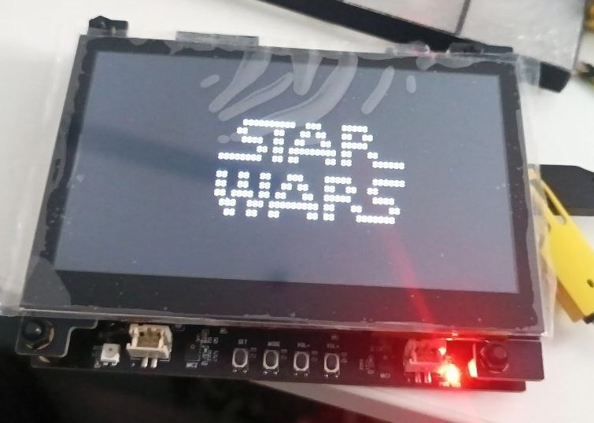

# ESP32-S31-Korvo-1 Rust examples

<p align="center">
  <br>
  <em>Demo 10: Star Wars over telnet on the LCD</em>
</p>

Bare-metal (`no_std`) Rust demos for the
[ESP32-S31-Korvo-1 V1.1](https://docs.espressif.com/projects/esp-dev-kits/en/latest/esp32s31/esp32-s31-korvo-1/user_guide.html)
development board (ESP32-S31-WROOM-3, 16 MB flash, 16 MB PSRAM), built on
[esp-hal](https://github.com/esp-rs/esp-hal) and Embassy.

## Requirements

- Rust stable with the `rust-src` component (pinned in `rust-toolchain.toml`).
- [`espflash`](https://github.com/esp-rs/espflash) 4.x.
- One USB-C cable into the **UART** port of the board, with the power switch set to ON.

The ESP32-S31 support in the released esp-rs crates is incomplete; for example, the Wi-Fi
connect hangs in esp-radio 1.0.0-beta.1. So the root `Cargo.toml` pins esp-hal, esp-rtos,
esp-radio, esp-alloc, esp-println, esp-backtrace and esp-bootloader-esp-idf to a single
esp-hal `main` commit with `[patch.crates-io]`. The first build downloads that commit from
GitHub.

## Running a demo

Every demo is its own binary in `examples/src/bin/`. Build in release mode, which the PSRAM
driver requires:

```bash
cargo run --release --bin 00_bringup
```

The cargo runner (`.cargo/config.toml`) flashes the board through the onboard CP2102
USB-UART bridge and then opens the serial monitor. Press `Ctrl+R` to reset the board and
`Ctrl+C` to quit. If flashing fails with a "Broken pipe" error, run the command again. If
it keeps failing, hold **Boot**, tap **Reset**, then release **Boot** to enter download
mode by hand.

Log verbosity follows `ESP_LOG` (default `info`), for example
`ESP_LOG=debug cargo run --release --bin 00_bringup`.

## Project layout

The repository is a Cargo workspace with two crates:

- **`esp32-s31-korvo`**: the board library. Pin map, PSRAM, LCD, buttons, RGB LED and
  the ES8389 microphones. Use it in your own firmware (see below).
- **`esp32-s31-korvo-examples`** (`examples/`): the demos, plus the app-level helpers
  (start-up, Wi-Fi, SNTP, telnet terminal) that only the demos need, so a firmware
  using the board doesn't pull in the network stack.

In both, the hardware-independent modules (button ladder decoding, gain steps, the
terminal parser, SNTP packets, dates) touch no peripheral and read no clock. They also
build for a PC, where they are unit-tested; everything else builds only for the
ESP32-S31.

| Path | Contents |
|------|----------|
| `esp32-s31-korvo/src/lib.rs` | Crate docs: what a firmware using the library needs |
| `esp32-s31-korvo/src/board.rs` | Board pin map, I2C device addresses, `init()`, logger, shared I2C bus, RGB LED setup and PSRAM mapping (`psram_reserve`, `psram_split`) |
| `esp32-s31-korvo/src/buttons.rs` | The four ADC-ladder buttons (polling, debouncing) and the BOOT button (GPIO61) |
| `esp32-s31-korvo/src/ladder.rs` | Ladder decoding: ADC code to voltage to button, debouncer (host-tested) |
| `esp32-s31-korvo/src/display.rs` | 800x480 RGB LCD driver: DPI timing, PSRAM frame buffer with AXI DMA, embedded-graphics `DrawTarget` |
| `esp32-s31-korvo/src/es8389.rs` | ES8389 codec driver (recording side, both ADC channels as microphones), ported from Espressif's `esp_codec_dev` |
| `esp32-s31-korvo/src/gain.rs` | ES8389 microphone gain steps, 0 to 36.5 dB (host-tested) |
| `esp32-s31-korvo/src/audio.rs` | I2S input stream from the ES8389 (16-bit stereo Philips, DMA ring buffer, restarts after an overflow) |
| `examples/src/lib.rs`, `demo.rs` | Helper crate root; the `start!` macro the demos begin with |
| `examples/src/terminal.rs` | 80x24 VT100/ANSI-subset terminal emulator (parser host-tested) and an incremental renderer for the LCD |
| `examples/src/net.rs` | Wi-Fi station setup, embassy-net stack with DHCP, reconnect task, SNTP client |
| `examples/src/sntp.rs`, `time.rs` | SNTP request and reply checks; UTC dates from Unix time (host-tested) |
| `examples/build.rs` | Linker script (`linkall.x`) and hints for common link errors |
| `examples/src/bin/NN_*.rs` | The demos |

## Using `esp32-s31-korvo` in your own firmware

The library isn't on crates.io; depend on it by git tag (or by `rev` until a tag
exists):

```toml
[dependencies]
esp32-s31-korvo = { git = "https://github.com/Hahihula/s31-korvo-1-rust-examples", tag = "v0.1.0", features = ["log"] }
```

```rust
let p = esp32_s31_korvo::board::init();       // HAL at 320 MHz
esp32_s31_korvo::board::init_logger();        // `log` feature: esp-println on UART0
esp_alloc::heap_allocator!(size: 96 * 1024);  // your heap; plain RAM (see board::init)
let display = Display::new(p.LCD_CAM, p.DMA_AXI_CH0, esp32_s31_korvo::lcd_pins!(p), fb)?;
```

What the firmware has to bring itself:

- **The esp-hal pins.** Copy the `[patch.crates-io]` section from the root `Cargo.toml`.
  Cargo applies `[patch]` only in the root manifest, so it can't travel with the
  library; without it you get the released esp-hal, whose ESP32-S31 support is
  incomplete. The pins are commits on esp-hal's `main` branch: if one disappears
  upstream, builds fail with "failed to find commit", and the weekly CI run here shows
  it. `libmudtelnet-rs` (demos only) points at a fork until a no_std fix is released.
- **The linker script.** A `build.rs` in the binary crate with
  `println!("cargo:rustc-link-arg=-Tlinkall.x");`; a dependency can't pass it.
- Copy `.cargo/config.toml` and `rust-toolchain.toml` as well.
- **The logger and the heap**: `board::init()` sets up neither. The `log` feature (off
  by default) adds `board::init_logger()` and with it `esp-println`.
- **Sharing the I2C bus.** Drivers take the bus by value or by `&mut`
  (`Es8389::new(&mut i2c)`), so the codec, camera and touch controller can share it.

Cargo pins the exact tag, so moving to a newer release means changing the tag.

## Tests and CI

The hardware-independent modules have unit tests that run on a PC. The workspace builds
for the ESP32-S31 by default, so give the host target:

```bash
cargo test -p esp32-s31-korvo -p esp32-s31-korvo-examples --lib --target aarch64-apple-darwin
```

(`x86_64-unknown-linux-gnu` and so on for other hosts.) Modules that need the chip are
behind `#[cfg(target_arch = "riscv32")]`, and their dependencies are listed under
`[target.'cfg(target_arch = "riscv32")'.dependencies]`.

GitHub Actions (`.github/workflows/ci.yml`) runs the tests, `cargo fmt --check`, clippy
on the library and all demos with warnings as errors, and a release build of every
demo, on every push and pull request and once a week (to catch a vanished esp-hal pin).

## Demos

### 00 – Board bring-up

```bash
cargo run --release --bin 00_bringup
```

Checks that the basic hardware is alive:

1. Prints the chip revision and the Wi-Fi station MAC address.
2. Detects the PSRAM, writes a pattern over all 16 MB, reads it back and reports errors
   and throughput.
3. Adds the PSRAM to the heap and allocates 1 MiB from it.
4. Scans the shared I2C bus (SDA GPIO0, SCL GPIO1) and names the devices it knows.
5. Reads the product ID of the touch controller on the LCD subboard.

Expected output (verified on a board with the LCD subboard attached):

```
INFO - === ESP32-S31-Korvo-1 bring-up ===
INFO - Chip revision: v0.0
INFO - Wi-Fi STA MAC: 30:ed:a0:..:..:..
INFO - PSRAM: 16384 KiB mapped at 0x50000000
INFO - PSRAM test: 0 bad words, write 220 ms (~72 MiB/s), read 223 ms (~71 MiB/s)
INFO - Heap: 1 MiB allocation at 0x50000000 OK
INFO - Scanning I2C bus (SDA=GPIO0, SCL=GPIO1)...
INFO -   0x10: ES8389 audio codec
INFO -   0x14: touch controller (Goodix)
INFO - I2C scan: 2 device(s)
WARN -   expected OV3660 camera (needs XCLK) at 0x3C did not answer
INFO - Touch at 0x14: Goodix GT1158
INFO - Bring-up done.
INFO - alive, uptime 10 s
```

The warning about the OV3660 camera is expected. The sensor only answers on I2C while it
receives a master clock on GPIO55, which this demo does not generate. Without the LCD
subboard, the touch controller at 0x14 is missing too.

### 01 – Function buttons

```bash
cargo run --release --bin 01_buttons
```

The PLAY, SET, VOL- and VOL+ buttons share a single ADC pin (GPIO42, ADC1 channel 0).
Each button pulls a 10 kΩ pull-up down to its own voltage:

| Button | Voltage | Expected raw ADC code |
|--------|---------|-----------------------|
| VOL+   | 0.38 V  | ~1780                 |
| VOL-   | 0.82 V  | ~1300                 |
| PLAY   | 1.34 V  | ~725                  |
| SET    | 1.87 V  | ~145                  |
| none   | 3.30 V  | 0 (clipped)           |

The ESP32-S31 ADC is differential and its scale runs **backwards**. A grounded input
reads about 2198, higher voltages give lower codes at about 0.91 mV per code, and
everything from about 2 V upwards reads 0. So `mV = 2000 - raw * 4000 / 4393`. The
idle 3.3 V is outside the range and reads 0, while all four buttons are below 2 V.
esp-hal has no S31 ADC calibration yet. The conversion comes from
[esp-touch-paint](https://github.com/playfulFence/esp-touch-paint).

The demo works like this:

1. At start-up it prints one idle reading, which should be raw 0, about 2000 mV.
2. It polls every 10 ms and accepts a button once three readings in a row agree.
3. For each press it prints the button, a per-button counter, the raw ADC code and the
   estimated voltage.
4. For each release it prints how long the button was held and the counts for all
   buttons.

Expected output (the raw and millivolt values vary a little from board to board):

```
INFO - === Demo 01: buttons (ADC ladder on GPIO42) ===
INFO - Idle: raw 0 (~2000 mV; 3.3 V idle clips at ~2000 mV)
INFO - Press PLAY, SET, VOL- or VOL+.
INFO - PLAY pressed  #1   (raw 727, ~1339 mV)
INFO - PLAY released after 182 ms
INFO - counts: PLAY=1 SET=0 VOL-=0 VOL+=0
```

The Reset and Boot buttons are not part of the ladder. Reset restarts the chip. Boot
(GPIO61) is a strapping pin used to enter download mode.

### 02 – RGB LED

```bash
cargo run --release --bin 02_rgb_led
```

Drives the onboard WS2812B addressable LED. GPIO37 feeds it through a BSS138 level
shifter (3.3 V to 5 V). The signal is generated by RMT channel 0 using the
[`esp-hal-smartled`](https://crates.io/crates/esp-hal-smartled) crate, with gamma
correction from [`smart-leds`](https://crates.io/crates/smart-leds).

It runs four effects:

| Effect | What you see |
|--------|--------------|
| rainbow | Smooth hue cycle, about 4 s per turn |
| breathing | Fades in and out every 3 s, with a different colour each breath |
| color test | Red, green, blue, white and off, one second each. If these don't match the log, the colour order is wrong |
| candle | Warm orange flicker |

The **BOOT** button (a plain digital input) controls the demo:

- **Short press:** next effect. The first press also turns off auto-advance.
- **Long press (1 s or more):** next brightness level (8, 32, 96, 255; the default is 32).

Until BOOT is pressed for the first time, the effects advance on their own every
10 seconds. Don't hold BOOT while pressing Reset, because that puts the chip into
download mode.

Expected output:

```
INFO - === Demo 02: RGB LED (WS2812B on GPIO37 via RMT) ===
INFO - BOOT: short press = next effect, long press (>= 1 s) = brightness
INFO - effect: rainbow (brightness 32)
INFO - effect: breathing
INFO - effect: color test (red, green, blue, white, off)
INFO -   color test: red
INFO -   color test: green
INFO -   color test: blue
INFO -   color test: white
INFO -   color test: off
INFO - effect: candle
INFO - auto-advance off
INFO - effect: rainbow
INFO - brightness 96
```

### 03 – Microphones

```bash
cargo run --release --bin 03_microphones
```

Starts the I2S clocks (the S31 is master, 16-bit stereo Philips at 16 kHz, no MCLK),
reads the ES8389's chip ID (`83 89`), configures it and prints the level of both
microphones twice a second. VOL+ and VOL- change the microphone gain in 3 dB steps
(0 to 36.5 dB, starting at 33.5 dB).

The codec runs as Espressif's Korvo-1 BSP sets it up, except that both ADC channels
are microphones (no DAC echo reference), so BCLK is 32 × fs. If the I2S ring overflows,
`AudioIn` restarts the stream and the demo logs the gap.

The first report includes the codec powering up (a full-scale click); after that,
a quiet room reads about -72 dBFS and speech at arm's length -20 to -35 dBFS:

```
INFO - ES8389 chip ID 83 89
INFO - ES8389 running, mic gain 33.5 dB
INFO - VOL+ / VOL- = mic gain
INFO - MIC1  -13.6 dBFS (peak    0.0)  MIC2  -13.4 dBFS (peak    0.0)
INFO - MIC1  -72.1 dBFS (peak  -59.7)  MIC2  -71.1 dBFS (peak  -58.9)
INFO - MIC1  -35.6 dBFS (peak  -17.1)  MIC2  -35.3 dBFS (peak  -17.9)
INFO - MIC1  -19.4 dBFS (peak   -9.0)  MIC2  -19.1 dBFS (peak   -8.7)
INFO - mic gain 36.5 dB
INFO - mic gain 33.5 dB
```

### 04 – Wi-Fi, DHCP, DNS and NTP

```bash
cargo run --release --bin 04_wifi
```

The Wi-Fi credentials are compiled into the firmware from the `WIFI_SSID` and
`WIFI_PASSWORD` environment variables. There are two ways to set them:

- **Credentials file:** copy `.cargo/wifi.toml.example` to `.cargo/wifi.toml` and fill
  it in. The file is gitignored, and cargo reads it on every build.
- **Environment variables:**
  `WIFI_SSID='my network' WIFI_PASSWORD='secret' cargo run --release --bin 04_wifi`.

Cargo rebuilds automatically when the credentials change. Leave out `WIFI_PASSWORD`, or
set it to an empty string, for an open network. Only
WPA2-Personal and open networks are supported; WPA3-only networks will not connect. The
ESP32-S31 supports 2.4 GHz only.

What the demo does:

1. Starts the Wi-Fi radio (esp-radio) and scans for networks, listing up to 15 with
   signal strength, channel and security type.
2. Connects to `WIFI_SSID`, warning first if the scan did not see that network. A
   background task reconnects every 5 s if the connection fails or drops. An attempt that
   gets no answer from the driver within 30 s is cancelled and retried.
3. Gets an IP address, gateway and DNS server over DHCP (embassy-net).
4. Looks up `towel.blinkenlights.nl` in DNS, the host demo 05 will connect to.
5. Fetches the time from `pool.ntp.org` with a minimal SNTP request over UDP. Only
   a reply from the server's address that echoes the request's random timestamp and
   comes from a synchronised server (stratum 1-15) is accepted.
6. Every 10 seconds prints the current UTC time (NTP time plus the time elapsed since)
   and the IP address. If NTP failed, it is retried each round instead.

Without `WIFI_SSID` the demo only runs the scan and then prints how to rebuild with
credentials. That is a quick way to check the radio without a network.

To see the Wi-Fi driver's own log while debugging a connection, add
`ESP_LOG=info,esp_radio=debug` in front of the `cargo run` command.

Expected output (values are examples):

```
INFO - === Demo 04: Wi-Fi, DHCP, DNS, NTP ===
INFO - Station configured for 'my network' (WPA2-Personal)
INFO - Scanning...
INFO - Found 14 access point(s):
INFO -    -37 dBm  ch 11  my network                       Some(Wpa2Personal)
INFO -    -64 dBm  ch  1  neighbour                        Some(Wpa2Personal)
...
INFO - Wi-Fi connecting...
INFO - Wi-Fi connected to 'my network' (channel 11, RSSI -38 dBm)
INFO - Waiting for DHCP...
INFO - DHCP: address 192.168.1.42/24, gateway Some(192.168.1.1), DNS [192.168.1.1]
INFO - DNS: towel.blinkenlights.nl -> [...]
INFO - NTP: 2026-10-27 15:00:31 UTC (1792940431)
INFO - 2026-10-27 15:00:41 UTC | IP Some(192.168.1.42/24)
```

The Wi-Fi driver needs about 60 KiB of internal RAM, so this demo adds a 96 KiB internal
heap on top of the small default one.

### 05 – Star Wars over telnet (console)

```bash
cargo run --release --bin 05_telnet_starwars
```

Plays the ASCII-art Star Wars movie served by `towel.blinkenlights.nl` in the terminal
running the serial monitor. It uses the same Wi-Fi credentials as demo 04
(`.cargo/wifi.toml` or the `WIFI_SSID` and `WIFI_PASSWORD` environment variables).

How it works:

1. Connects to Wi-Fi, gets an address over DHCP and resolves `towel.blinkenlights.nl`.
2. Opens a TCP connection to port 23 (telnet).
3. Feeds everything it receives into the
   [`libmudtelnet-rs`](https://crates.io/crates/libmudtelnet-rs) parser. The parser
   strips the telnet commands and answers the server's option requests by refusing them.
4. Writes the remaining data, including its ANSI cursor-movement codes, straight to the
   UART. The terminal running `espflash monitor` interprets those codes, so the frames
   animate in place.
5. When the server closes the connection, or no data arrives for 60 s, it logs the
   session length and reconnects after 10 s. The movie then starts again.

Make the terminal window at least 80×24 characters. Press `Ctrl+C` to quit the monitor.

Expected output before the movie starts:

```
INFO - === Demo 05: Star Wars over telnet (towel.blinkenlights.nl:23) ===
INFO - Waiting for network...
INFO - Wi-Fi connecting...
INFO - Wi-Fi connected to 'my network' (channel 11, RSSI -41 dBm)
INFO - IP address 192.168.1.42/24
INFO - Make the terminal at least 80x24. Press Ctrl+C to quit the monitor.
INFO - Connecting to 213.136.8.188:23...
INFO - Connected, the movie starts in a moment.
```

About the telnet crate: `libmudtelnet-rs` 2.0.10 claims `no_std` support, but it
depends on `bytes` with default features, which pulls in `std`. That makes it fail on
`riscv32imafc-unknown-none-elf` with "can't find crate for `std`". `Cargo.toml` therefore
patches it to a fork,
[Hahihula/libmudtelnet-rs @ `192001c`](https://github.com/Hahihula/libmudtelnet-rs/commits/fix/no-std-bytes/),
which depends on `bytes` with `default-features = false`, forwards the crate's `std`
feature to `bytes/std`, and adds a CI check for a real no_std target. Once the fix is
released upstream, the `[patch.crates-io]` entry can be dropped.

### 08 – RGB LCD

```bash
cargo run --release --bin 08_display
```

Drives the 4.3-inch 800×480 LCD subboard (ESP32-S3-LCD-EV-Board-SUB3) over the
16-bit parallel RGB interface (LCD_CAM in DPI mode). The subboard needs no
initialisation commands, and its backlight is always on.

On screen you should see:

- **Top:** eight colour bars (white, yellow, cyan, green, magenta, red, blue, black).
- **Middle:** four 32-step ramps (grey, red, green, blue). Smooth ramps without missing
  or swapped steps mean all 16 data lines are wired and mapped correctly.
- **Edges:** a one-pixel white border. All four sides should be visible.
- **Below:** a title line and a frame counter in the top right of the animation area.
- **Bottom:** a square bouncing in the framed area and changing colour every 30 frames.

The log prints the frame rate every five seconds:

```
INFO - === Demo 08: RGB LCD 800x480 ===
INFO - PSRAM size: 16 MB
INFO - Test pattern drawn, animating
INFO - 35.4 fps
```

How it works:

- **Frame buffer:** the first 768,000 bytes of PSRAM (`board::psram_split`). The rest of
  PSRAM becomes heap.
- **Continuous refresh:** the DMA descriptors over the frame buffer form a ring, and the
  LCD runs in continuous-frame mode. Once started, the panel is refreshed at a constant
  35.4 Hz with no CPU involvement. The AXI DMA reads PSRAM in 64-byte bursts; the ~190
  descriptors live in internal RAM.
- **Drawing:** `Display::canvas()` is an embedded-graphics `DrawTarget` over the buffer.
  It draws straight into memory that is being scanned out, so fast changes can tear
  briefly. `Display::present()` writes the changed rows back from the CPU cache, so the
  DMA sees them, then waits for the next frame start (VSYNC). The wait is asynchronous,
  so other tasks run meanwhile.
- **Draw first, then present:** the stream starts with the first `present()` call. Draw
  the initial screen before that. See the pitfalls below for why.
- **Self-correcting:** if the picture ever drifts, `present()` notices at the next frame
  start and realigns it with one short blink.
- **Timing:** the panel values come from Espressif's esp-bsp
  (`SUB_BOARD3_800_480_PANEL_35HZ_RGB_TIMING`): 18 MHz pixel clock, HSYNC 40/40/48 and
  VSYNC 23/32/13 (pulse / back porch / front porch).

Pitfalls found while bringing up this panel on the ESP32-S31 (all on the board, with the
pinned esp-hal `main`):

- **Uneven gaps between frames:** sending one frame per `send()` and drawing between
  frames lets the pause between frames vary. The panel then loses sync and fades to
  black, even though the DMA reports no errors. A constant gap is fine. That is why
  the LCD streams continuously.
- **Restarting every frame:** restarting the stream at each VSYNC to stay aligned
  makes the picture blink, because the restart lands at a slightly different time
  each frame.
- **PSRAM falling behind the LCD:** PSRAM has little headroom here. esp-hal runs it
  octal at 200 MHz, and we measured about 55 MB/s for DMA against the 36 MB/s the panel
  needs. Heavy drawing, Wi-Fi activity or even logging (formatting code fetched from
  flash) can starve the DMA for a moment. The LCD keeps its timing, the data falls
  behind, and without a fix the picture stays shifted from then on, sideways first,
  then down the screen as it adds up. Two things handle this:
  - **Draw first, then present:** the stream starts with the first `present()`, so the
    initial screen is drawn while the DMA is idle.
  - **Automatic resync:** during vertical blanking the DMA fills its FIFOs and waits,
    so an aligned stream is always at the same ring position at VSYNC. The first row
    of the ring uses 64-byte descriptors (32 pixels), so `present()` can read the
    position from the AXI DMA's `OUT_DSCR` register precisely. When the position
    differs from the one recorded right after the start, `present()` restarts the
    stream: one short blink instead of a shifted picture. `Display::resyncs()` counts
    these.
- **Pixel clock:** the panel shows nothing usable at 6 or 9 MHz. Keep it at 18 MHz.
- **Internal-RAM bursts:** keep them enabled (`InternalBurstConfig::Enabled`) for the
  descriptors.

### 10 – Star Wars over telnet (LCD)

```bash
cargo run --release --bin 10_starwars_lcd
```

The same stream as demo 05, rendered on the LCD instead of the serial console. It uses
the Wi-Fi credentials from demo 04 (`.cargo/wifi.toml`, or the `WIFI_SSID` and
`WIFI_PASSWORD` environment variables).

How it works:

- **Telnet task:** connects to `towel.blinkenlights.nl:23` and runs the stream through
  `libmudtelnet-rs`. The text goes into an 80×24 terminal emulator (`examples/src/terminal.rs`).
  The emulator understands cursor positioning, the erase-screen and erase-line codes,
  cursor moves, CR/LF, backspace and tab. It ignores colour codes and anything it does
  not know.
- **Display loop:** each frame it copies the 1,920-character grid under a mutex. It then
  redraws only the characters that differ from what is on the panel, using the 10×20
  font, so 80×24 characters fill the 800×480 panel exactly.
- **Redraw cap:** at most 80 characters are redrawn per frame. Each character row is only
  20 bytes wide, so the CPU cache first reads the whole 64-byte line from PSRAM before
  writing. At 240 characters per frame, those reads still made the LCD stream drift in
  busy scenes; at 80, a full scene change settles in about 0.7 s. Characters are
  copied from glyphs pre-rendered into internal RAM, so no font data is read from
  flash.
- **Status messages:** Wi-Fi, connecting, errors and reconnects appear on the panel as
  well as on the console. When the server closes the connection, or nothing arrives
  for 60 s, the demo reconnects after 10 s.
- **No PSRAM heap:** only the frame buffer is taken from PSRAM (`board::psram_reserve`),
  so all Wi-Fi memory stays in internal RAM.

Without credentials, the panel shows a hint to set `WIFI_SSID` and nothing else
happens.

Expected console output:

```
INFO - === Demo 10: Star Wars over telnet on the LCD ===
INFO - PSRAM size: 16 MB
INFO - Connecting to Wi-Fi...
INFO - Wi-Fi connecting...
INFO - Waiting for the network...
INFO - Wi-Fi connected to 'my network' (channel 11, RSSI -41 dBm)
INFO - Resolving host name...
INFO - Connecting...
INFO - Connected to 213.136.8.188:23
INFO - display: 35 fps, 0 resyncs so far
```

If PSRAM falls behind (most likely while Wi-Fi is busy), the console shows
`display: stream drifted ..., resync #N` and the panel blinks once instead of staying
shifted.

## License

Licensed under either of [Apache License, Version 2.0](LICENSE-APACHE) or
[MIT license](LICENSE-MIT), at your option.

The ES8389 driver (`esp32-s31-korvo/src/es8389.rs`) is ported from Espressif's
`esp_codec_dev` (Apache-2.0), as noted in the file.

Unless you explicitly state otherwise, any contribution intentionally submitted for
inclusion in the work by you, as defined in the Apache-2.0 license, shall be dual
licensed as above, without any additional terms or conditions.
